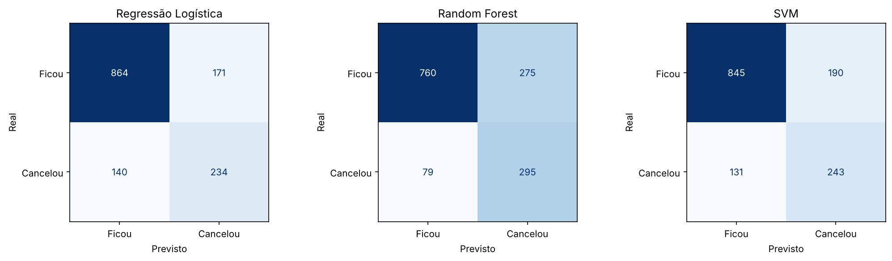
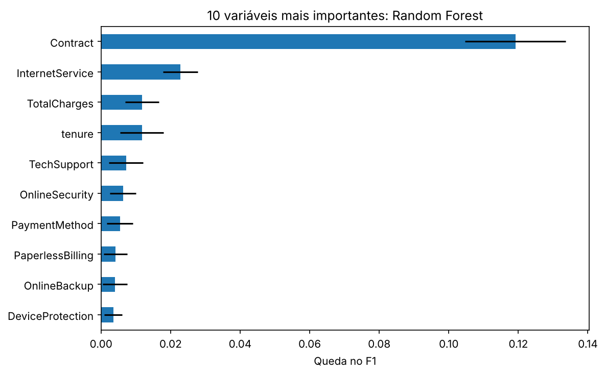

```text
 ██████╗██╗  ██╗██╗   ██╗██████╗ ███╗   ██╗
██╔════╝██║  ██║██║   ██║██╔══██╗████╗  ██║
██║     ███████║██║   ██║██████╔╝██╔██╗ ██║
██║     ██╔══██║██║   ██║██╔══██╗██║╚██╗██║
╚██████╗██║  ██║╚██████╔╝██║  ██║██║ ╚████║
 ╚═════╝╚═╝  ╚═╝ ╚═════╝ ╚═╝  ╚═╝╚═╝  ╚═══╝
```

<div align="center">

# 📡 PREVISÃO DE CHURN EM TELECOMUNICAÇÕES v1.0 📡

***MACHINE LEARNING A SERVIÇO DA RETENÇÃO DE CLIENTES!***

👩‍💻 **Karoline Costa** · 👨‍💻 **Gabriel Sad** · 🎓 Machine Learning, Unidade 3

</div>


---

<h2 align="center">🔍 VISÃO GERAL DO SISTEMA 🔍</h2>


```text
╔═══════════════════════════════════════════════════════════════╗
║  Este projeto prevê se um cliente de telecomunicações vai     ║
║  CANCELAR o serviço (churn). É uma classificação binária!     ║
║                                                               ║
║  Reter um cliente costuma custar menos que conquistar outro,  ║
║  então identificar o risco permite AGIR ANTES.                ║
╚═══════════════════════════════════════════════════════════════╝
```

---

<h2 align="center">💾 BASE DE DADOS 💾</h2>


Base pública **Telco Customer Churn** (Kaggle), em CSV.

| 📋 ITEM | 🔢 VALOR |
|---|---|
| Clientes | 7.043 |
| Variáveis preditoras | 19 (perfil, serviços, contrato e cobrança) |
| Alvo | `Churn` (Yes/No) |
| Cancelamentos | 26,5% (classes desbalanceadas) |


---

<h2 align="center">⚙️ COMO FUNCIONA ⚙️</h2>


```text
┌───────────────────────────┐
│     CARREGAR OS DADOS     │
└─────────────┬─────────────┘
              ▼
┌───────────────────────────┐
│     LIMPAR E CODIFICAR    │
└─────────────┬─────────────┘
              ▼
┌───────────────────────────┐
│    DIVIDIR 60 / 20 / 20   │
└─────────────┬─────────────┘
              ▼
┌───────────────────────────┐
│  TREINAR COM GRID SEARCH  │
└─────────────┬─────────────┘
              ▼
┌───────────────────────────┐
│   ESCOLHER NA VALIDACAO   │
└─────────────┬─────────────┘
              ▼
┌───────────────────────────┐
│      AVALIAR NO TESTE     │
└───────────────────────────┘
```

---

<h2 align="center">🧹 PRÉ-PROCESSAMENTO 🧹</h2>


```text
┌───────────────────────────────────────────────────────────────┐
│  [x] TotalCharges convertido em número (0 quando tenure = 0)  │
│  [x] Remoção de duplicatas e de customerID                    │
│  [x] Numéricas: mediana + StandardScaler                      │
│  [x] Categóricas: moda + one-hot encoding                     │
│  [x] Tudo em Pipeline, ajustado só no treino (sem vazamento)  │
└───────────────────────────────────────────────────────────────┘
```


Divisão estratificada (semente 42): **4.225** no treino, **1.409** na validação e **1.409** no teste.


---

<h2 align="center">🧠 MODELOS EM AÇÃO 🧠</h2>


`GridSearchCV` com 5 dobras estratificadas, otimizando F1. Um classificador trivial serve de referência.

| 🤖 MODELO | 🎛️ MELHORES HIPERPARÂMETROS | 📈 F1 (CV) |
|---|---|---|
| Regressão Logística | C = 0,01; pesos balanceados | 0,621 |
| Random Forest | 400 árvores; profundidade 10; folha mínima 5; balanceado | 0,632 |
| SVM | C = 0,1; kernel RBF; pesos balanceados | 0,621 |

O limiar de decisão e o modelo final são escolhidos na validação.


---

<h2 align="center">🏆 RESULTADOS NO TESTE 🏆</h2>


1.409 clientes, 374 cancelamentos, com limiar ajustado na validação:

| Modelo | Acurácia | Precisão | Recall | F1 | ROC-AUC | PR-AUC |
|---|---|---|---|---|---|---|
| Referência (sempre "Não") | 0,735 | 0,000 | 0,000 | 0,000 | 0,500 | 0,265 |
| Regressão Logística | 0,779 | 0,578 | 0,626 | 0,601 | 0,830 | 0,621 |
| ⭐ **Random Forest** | **0,749** | **0,518** | **0,789** | **0,625** | **0,830** | **0,629** |
| SVM | 0,772 | 0,561 | 0,650 | 0,602 | 0,820 | 0,586 |


```text
╔═══════════════════════════════════════════════════╗
║  RANDOM FOREST (escolhido na validação)           ║
║                                                   ║
║  Cancelamentos detectados ..... 295 de 374 (79%)  ║
║  Cancelamentos não detectados .. 79               ║
║  Alarmes falsos ............... 275               ║
╚═══════════════════════════════════════════════════╝
```

---

<h2 align="center">💬 DISCUSSÃO 💬</h2>


- Os três modelos têm desempenho muito próximo. No limiar padrão, a Regressão Logística teve F1 0,623 e recall 0,805, praticamente empatada com o Random Forest.
- O ajuste de limiar não melhorou o F1 no teste da Regressão Logística (0,623 para 0,601) nem do SVM (0,618 para 0,602).
- A referência trivial acerta 73,5% sem detectar nenhum cancelamento: a acurácia sozinha engana.
- Variáveis mais importantes (permutação): `Contract` (de longe), `InternetService`, `TotalCharges`, `tenure` e `TechSupport`. Importância não implica causalidade.


<div align="center">





</div>


---

<h2 align="center">🚀 CONCLUSÕES E PRÓXIMAS FASES 🚀</h2>


O **Random Forest** foi o escolhido, e a **Regressão Logística** é uma alternativa mais simples. O contrato mensal concentra o risco (43,1% de churn no treino, contra 2,9% no bienal).


```text
┌────────────────────────────────────────────────────────┐
│  > Testar Gradient Boosting e redes neurais            │
│  > Criar novas variáveis e testar SMOTE                │
│  > Definir o limiar pelo custo de cada erro            │
│  > Calibrar probabilidades e usar dados mais recentes  │
└────────────────────────────────────────────────────────┘
```

---

<h2 align="center">🎮 COMO REPRODUZIR 🎮</h2>


### ☁️ Google Colab
1. Abra `churn_telco.ipynb`.
2. Clique em **Ambiente de execução > Executar tudo**.
3. Quando solicitado, envie o ZIP ou CSV da base.

### 💻 No seu computador
```bash
pip install -r requirements.txt
# o ZIP ou CSV da base deve estar nesta pasta
jupyter notebook churn_telco.ipynb
```


---

<h2 align="center">📁 ARQUIVOS DO PROJETO 📁</h2>


```text
.
├── churn_telco.ipynb    código completo
├── requirements.txt     dependências
├── README.md            este guia
├── figuras/             gráficos gerados
└── resultados/          tabelas em CSV
```


---


```text
╔════════════════════════════════════════════════════════╗
║  OBRIGADO por visitar o nosso PREVISOR DE CHURN v1.0!  ║
║  Que nenhum cliente saia sem ser notado!               ║
╚════════════════════════════════════════════════════════╝
```

```text
███████╗██╗███╗   ███╗
██╔════╝██║████╗ ████║
█████╗  ██║██╔████╔██║
██╔══╝  ██║██║╚██╔╝██║
██║     ██║██║ ╚═╝ ██║
╚═╝     ╚═╝╚═╝     ╚═╝
```
